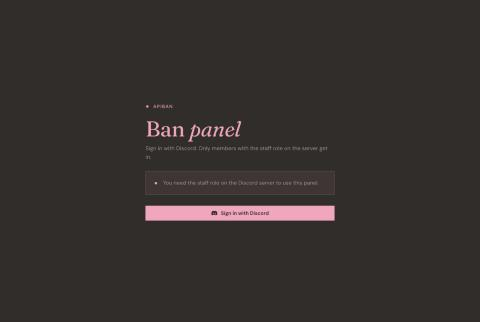
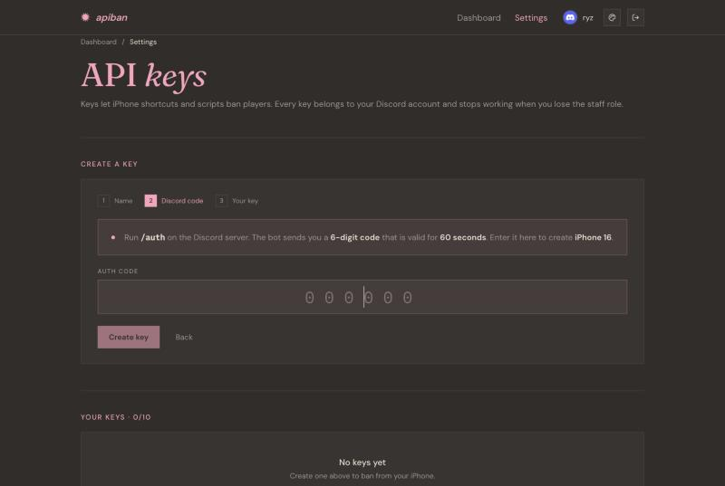
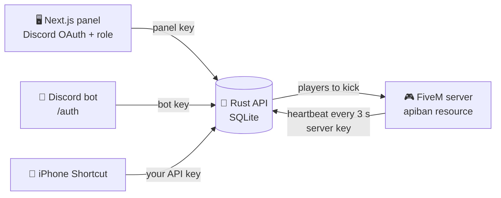

<div align="center">

# ✹ apiban

**Ban players on your FiveM server from a web panel, in game, or with one tap on your iPhone.**

Rust API · Lua resource · Next.js panel · Discord bot (TypeScript) · iOS Shortcuts

</div>

<p align="center">
  
  
</p>
<p align="center">
  
  
</p>

---

## Contents

- [Features](#features)
- [How it works](#how-it-works)
- [Setup](#setup)
  - [1. Discord application](#1-discord-application)
  - [2. API (Rust)](#2-api-rust)
  - [3. Discord bot (TypeScript)](#3-discord-bot-typescript)
  - [4. Web panel (Next.js)](#4-web-panel-nextjs)
  - [5. FiveM resource (Lua)](#5-fivem-resource-lua)
- [Creating an API key](#creating-an-api-key)
- [iPhone Shortcut](#iphone-shortcut)
- [In-game commands and export](#in-game-commands-and-export)
- [API reference](#api-reference)
- [Security](#security)
- [Deployment](#deployment)
- [License](#license)

## Features

- **Discord login**: the panel uses Discord OAuth. Only members of your server who have the staff role get in, and losing the role locks them out.
- **API keys through Discord**: in the panel you create a key, run `/auth` in Discord, and type in the 6-digit code from the bot (valid for 60 seconds).
- **Ban from anywhere**: web panel, iPhone Shortcut (also via Siri), `/ban` in game, or any script that can send a `POST` request.
- **Instant kicks**: online players are removed within about 3 seconds and see a full-screen ban screen first.
- **Ban card on join**: banned players see a card in the connecting screen with the reason, ban ID, expiry and an appeal button.
- **Hard to evade**: bans store every identifier (license, Discord, Steam, FiveM, Xbox, ...) plus hardware tokens.
- **Temporary or permanent**: `30m`, `12h`, `7d`, `2w`, `1y` or `perm`.
- **Small**: one Rust binary with an embedded SQLite database.

## How it works



1. The **FiveM resource** sends a heartbeat every 3 seconds with the online players and their identifiers.
2. Someone bans a player from the panel, an iPhone or in game, and the **API** stores the ban.
3. The next heartbeat answers with that player. The resource shows the **ban screen** and drops them.
4. When a banned player reconnects, the resource checks them during `playerConnecting` and shows the **ban card**.
5. The **Discord bot** hands out `/auth` codes. Every minute it also checks that everyone with an API key still has the staff role, and revokes the keys of anyone who lost it.

The FiveM server only makes outgoing requests, so you don't need to open a port on it.

```
apiban/
├── api/            Rust API (axum + SQLite)
├── bot/            Discord bot (discord.js)
├── fivem/apiban/   FiveM resource (Lua + NUI ban screen)
├── web/            Next.js panel
└── docs/           Screenshots
```

## Setup

You need [Rust](https://rustup.rs) 1.85+, [Node.js](https://nodejs.org) 22+, a Discord server and a FiveM server.

### 1. Discord application

1. Open the [Discord Developer Portal](https://discord.com/developers/applications) and create an application.
2. **Bot** tab: click *Reset Token* and copy the **bot token**. No privileged intents are needed.
3. **OAuth2** tab: copy the **client ID** and **client secret**, then add the redirect URL of your panel:
   `https://bans.example.com/auth/callback` (for local testing: `http://localhost:3000/auth/callback`).
4. Invite the bot to your server (replace the client ID):
   `https://discord.com/oauth2/authorize?client_id=YOUR_CLIENT_ID&scope=bot+applications.commands&permissions=0`
5. In Discord, turn on *Settings → Advanced → Developer Mode*. Right-click your server for the **server ID**, and right-click the staff role (*Server Settings → Roles*) for the **role ID**.

### 2. API (Rust)

```bash
cd api
cargo build --release
./target/release/apiban-api keygen fivem-server server
./target/release/apiban-api keygen discord-bot bot
./target/release/apiban-api keygen web-panel panel
```

Each `keygen` prints a **token** (shown once) and a `[[keys]]` block. Copy `config.example.toml` to `config.toml`, paste in the three blocks and start the API:

```bash
./target/release/apiban-api
```

It reads `./config.toml` (or the path in `APIBAN_CONFIG`) and creates `apiban.db` on first start. Check it with `curl http://127.0.0.1:8080/health`.

| Key role | Used by | Can |
| --- | --- | --- |
| `server` | FiveM resource | heartbeat, join checks, in-game `/ban` and `/unban` |
| `bot` | Discord bot | issue `/auth` codes, revoke keys of users without the role |
| `panel` | Web panel | manage bans, turn codes into API keys, list and revoke a user's keys |

API keys for people (iPhones, scripts) are not in the config. They are created in the panel, see [Creating an API key](#creating-an-api-key).

### 3. Discord bot (TypeScript)

```bash
cd bot
cp .env.example .env
npm ci
npm run build
npm start
```

| Variable | Value |
| --- | --- |
| `DISCORD_BOT_TOKEN` | Bot token from step 1 |
| `DISCORD_GUILD_ID` | Server ID |
| `DISCORD_ROLE_ID` | Staff role ID |
| `APIBAN_API_URL` | URL of the API, e.g. `http://127.0.0.1:8080` |
| `APIBAN_BOT_KEY` | Token of the `bot` key |

The bot registers `/auth` on your server when it starts.

### 4. Web panel (Next.js)

```bash
cd web
cp .env.example .env.local
npm ci
npm run build
npm start
```

| Variable | Value |
| --- | --- |
| `APP_URL` | Public URL of the panel, e.g. `https://bans.example.com` |
| `SESSION_SECRET` | 32+ random characters, e.g. from `openssl rand -hex 32` |
| `APIBAN_API_URL` | URL of the API, reachable from the panel server |
| `APIBAN_PANEL_KEY` | Token of the `panel` key |
| `DISCORD_CLIENT_ID` / `DISCORD_CLIENT_SECRET` | From the OAuth2 tab |
| `DISCORD_BOT_TOKEN` | Bot token, used to check the role on every visit |
| `DISCORD_GUILD_ID` / `DISCORD_ROLE_ID` | Server ID and staff role ID |

Open the panel and click **Sign in with Discord**. People without the role are sent back to the login page.

### 5. FiveM resource (Lua)

1. Copy `fivem/apiban` into your server's `resources` folder.
2. Add to `server.cfg`, using the token of the `server` key:

   ```cfg
   set apiban_url "https://api.example.com"
   set apiban_key "apiban_..."
   ensure apiban
   add_ace group.admin apiban.ban allow
   ```

   Use `set`, not `setr` or `sets`, so the key is never sent to players or the server list.

3. Adjust `config.lua`:

   | Option | Default | Meaning |
   | --- | --- | --- |
   | `ServerName` | `'My FiveM Server'` | Shown on the ban card and ban screen |
   | `AppealUrl` | Discord invite | Appeal link; `nil` hides it |
   | `KickDelay` | `10` | Seconds the ban screen is shown before the player is dropped |
   | `AllowJoinWhenApiDown` | `true` | Let players join while the API is unreachable |
   | `IgnoredIdentifiers` | `{ ip = true }` | Identifier types that are not stored in bans |
   | `UseHardwareTokens` | `true` | Also ban the player's hardware tokens |

## Creating an API key

1. Sign in to the panel and open **Settings**.
2. Give the key a name, for example `iPhone`, and click **Continue**.
3. Run **`/auth`** on your Discord server. If you have the staff role, the bot replies with a **6-digit code** that only you can see. The code works for **60 seconds**, only once, and only for your account.
4. Enter the code in the panel. Your **API key** appears once: copy it right away.

Every key is signed with your Discord name, so bans show up as `ryz (iPhone)`. You can have up to 10 keys and revoke any of them in Settings. If you lose the staff role, the bot revokes all your keys within a minute.

## iPhone Shortcut

Create a shortcut called `Ban Player` in the **Shortcuts** app:

1. **Ask for Input**: type *Number*, prompt `Player ID`
2. **Ask for Input**: type *Text*, prompt `Reason`
3. **List**: `1h`, `1d`, `7d`, `30d`, `perm`
4. **Choose from List**: prompt `Duration`
5. **Get Contents of URL**
   - URL: `https://api.example.com/v1/bans`
   - Method: `POST`
   - Headers: `Authorization` = `Bearer apiban_...` (your key from the panel)
   - Request Body: `JSON`
     - `player` (Number) = *Provided Input* from step 1
     - `reason` (Text) = *Provided Input* from step 2
     - `duration` (Text) = *Chosen Item*
6. **Get Dictionary Value**: `message` from *Contents of URL*
7. **If** *Dictionary Value* **has any value**: **Show Notification** *Dictionary Value*.
   **Otherwise**: **Get Dictionary Value** `error` from *Contents of URL* and **Show Alert** with it.

Run it from the Home Screen or say *"Hey Siri, Ban Player"*. On success you get a notification like `Banned Cheater (#12) for 1 week`.

<details>
<summary><b>Variant: pick the player from the online list</b></summary>

Replace step 1 with:

1. **Get Contents of URL**: `GET https://api.example.com/v1/players` with the same `Authorization` header
2. **Get Dictionary Value**: `players`
3. **Repeat with Each** item in *Dictionary Value*: **Text** `[Repeat Item → id] · [Repeat Item → name]`
4. **Choose from List**: *Repeat Results*
5. **Split Text** *Chosen Item* by ` · `, then **Get Item from List**: *First Item*

Use that first item as `player` in the request body.

</details>

To unban from your phone, make a second shortcut that sends `DELETE` to `https://api.example.com/v1/bans/<ban id>` with the same header.

> Never share a shortcut that contains your key. If a phone gets lost, revoke its key in Settings.

## In-game commands and export

| Command | Example |
| --- | --- |
| `/ban <id> <duration> <reason>` | `/ban 12 7d Aimbot` |
| `/unban <ban id>` | `/unban 12` |

Both need the `apiban.ban` ACE permission (the server console can always use them). The ban is stored with the admin's name.

Other resources (anticheats, admin menus) can ban through the export:

```lua
exports.apiban:BanPlayer(source, 'Cheating detected', '30d', 'AntiCheat', function(ok, message, ban)
    print(ok, message)
end)
```

`duration` and the callback are optional; without a duration the ban is permanent.

## API reference

Every request needs `Authorization: Bearer <token>`. Bodies are JSON, and errors look like `{"error": "..."}`.

| Method | Path | Keys | Description |
| --- | --- | --- | --- |
| `GET` | `/health` | none | Liveness check |
| `GET` | `/v1/me` | any | Name and role of the key |
| `GET` | `/v1/players` | user, panel, server | Online players from the last heartbeat |
| `GET` | `/v1/bans` | user, panel, server | List bans: `?status=all\|active\|expired\|revoked&q=&limit=&offset=` |
| `POST` | `/v1/bans` | user, panel, server | Create a ban |
| `GET` | `/v1/bans/{id}` | user, panel, server | One ban |
| `DELETE` | `/v1/bans/{id}` | user, panel, server | Unban |
| `POST` | `/v1/server/heartbeat` | server | Report online players, get players to kick |
| `POST` | `/v1/server/check` | server | Check identifiers while a player connects |
| `POST` | `/v1/auth/codes` | bot | Issue a 6-digit code for a Discord user |
| `POST` | `/v1/auth/redeem` | panel | Turn a code into an API key |
| `GET` | `/v1/keys?discord_id=` | panel | A user's API keys |
| `DELETE` | `/v1/keys/{id}?discord_id=` | panel | Revoke one of a user's keys |
| `GET` | `/v1/keys/owners` | bot | Discord IDs that own active keys |
| `DELETE` | `/v1/users/{discord_id}/keys` | bot | Revoke all keys of a user |

**Create a ban**: send `player` (server ID of an online player) or `identifiers` (for offline players).

```bash
curl -X POST https://api.example.com/v1/bans \
  -H "Authorization: Bearer apiban_..." \
  -H "Content-Type: application/json" \
  -d '{"player": 12, "reason": "Aimbot", "duration": "7d"}'
```

```json
{
  "message": "Banned Cheater (#1) for 1 week",
  "ban": {
    "id": 1,
    "player_name": "Cheater",
    "identifiers": ["license:aaa111"],
    "reason": "Aimbot",
    "banned_by": "ryz (iPhone)",
    "created_at": 1795306908,
    "expires_at": 1795911708,
    "revoked_at": null,
    "revoked_by": null,
    "status": "active"
  }
}
```

| Field | Required | Notes |
| --- | --- | --- |
| `reason` | yes | Up to 500 characters |
| `player` | one of | Server ID, as a number or numeric string |
| `identifiers` | one of | e.g. `["license:abc", "discord:123"]` |
| `name` | no | Player name when banning by identifiers |
| `duration` | no | `30m`, `12h`, `7d`, `2w`, `1y`; empty or `perm` means permanent |

Timestamps are Unix seconds. `banned_by` comes from the key, so nobody can ban in someone else's name.

## Security

- **Role-gated panel**: Discord OAuth plus a role check through the bot token at sign-in and again every minute while you use the panel. The session is an HMAC-signed `httpOnly` cookie.
- **Codes bound to the account**: an `/auth` code only works for the Discord account that requested it, expires after 60 seconds, works once and is deleted after 5 wrong tries.
- **Keys follow the role**: the bot checks all key owners every minute and revokes the keys of anyone who lost the role or left the server.
- **Hashed at rest**: service tokens are stored as SHA-256 hashes in `config.toml`, user keys as SHA-256 hashes in the database. API keys are shown once and never again.
- **Separate roles**: each key type can only call its own endpoints, so a user key cannot fake heartbeats or issue codes.
- **HTTPS**: put the API and the panel behind a reverse proxy with TLS. The API listens on `127.0.0.1` by default.
- **Validation**: identifiers, reasons, durations and names are checked and length-limited by the API. The ban screen renders text only, never HTML.

## Deployment

**HTTPS with [Caddy](https://caddyserver.com)** (`/etc/caddy/Caddyfile`):

```caddy
api.example.com {
    reverse_proxy 127.0.0.1:8080
}

bans.example.com {
    reverse_proxy 127.0.0.1:3000
}
```

**API as a systemd service** (`/etc/systemd/system/apiban.service`):

```ini
[Unit]
Description=apiban API
After=network.target

[Service]
WorkingDirectory=/opt/apiban
ExecStart=/opt/apiban/apiban-api
Environment=APIBAN_CONFIG=/opt/apiban/config.toml
Restart=always
User=apiban

[Install]
WantedBy=multi-user.target
```

Run the bot (`npm start` in `bot/`) and the panel (`npm start` in `web/`) the same way, or with pm2. Back up `apiban.db` to keep your bans and keys.

**Development**: `cargo test` in `api/` runs the API tests, and `npm run dev` in `web/` starts the panel with hot reload.

## License

[MIT](LICENSE)
