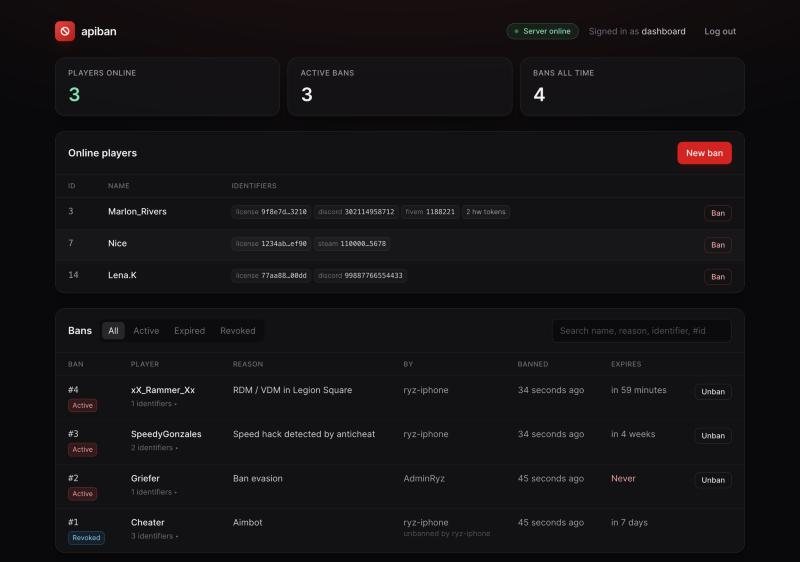
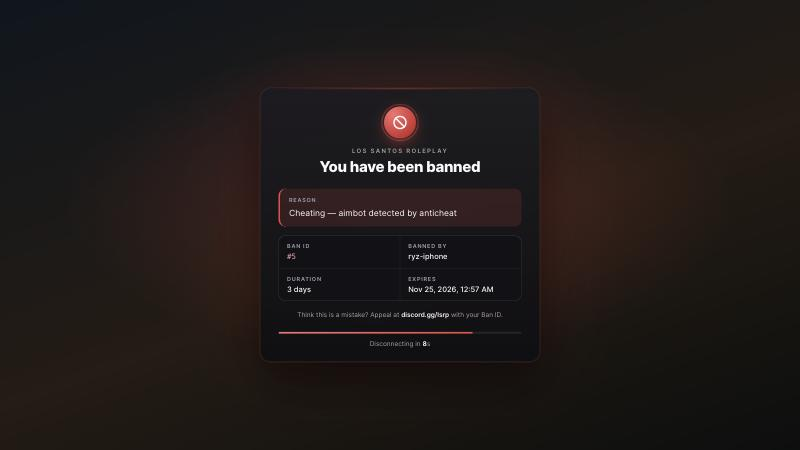
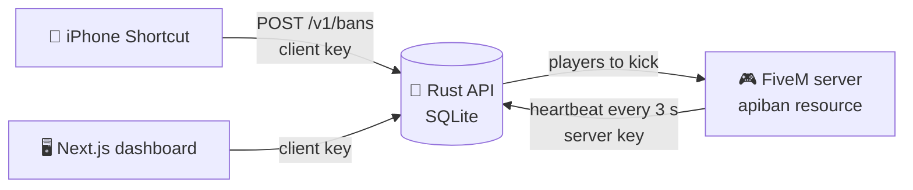

<div align="center">

# apiban

**Ban players on your FiveM server from a web dashboard, in game, or with one tap on your iPhone.**

Rust API · Lua resource · Next.js dashboard · iOS Shortcuts

</div>

<p align="center">
  
  
</p>

---

## Contents

- [Features](#features)
- [How it works](#how-it-works)
- [Setup](#setup)
  - [1. API (Rust)](#1-api-rust)
  - [2. FiveM resource (Lua)](#2-fivem-resource-lua)
  - [3. Dashboard (Next.js)](#3-dashboard-nextjs)
- [iPhone Shortcut](#iphone-shortcut)
- [In-game commands and export](#in-game-commands-and-export)
- [API reference](#api-reference)
- [Security](#security)
- [Deployment](#deployment)
- [License](#license)

## Features

- **Ban from anywhere**: web dashboard, iPhone Shortcut (also via Siri), `/ban` in game, or any script that can send a `POST` request.
- **Instant kicks**: online players are removed within ~3 seconds and see a full-screen ban screen first.
- **Ban card on join**: banned players get a clean card in the connecting screen with reason, ban ID, expiry and an appeal button.
- **Hard to evade**: bans store every identifier (license, Discord, Steam, FiveM, Xbox, ...) plus hardware tokens.
- **Temporary or permanent**: `30m`, `12h`, `7d`, `2w`, `1y` or `perm`.
- **Per-device keys**: only the iPhones you hand a key to can ban, and every ban is logged with the key's name.
- **Small and fast**: one Rust binary with an embedded SQLite database, no external database needed.

## How it works



1. The **FiveM resource** sends a heartbeat every 3 seconds with the online players and their identifiers.
2. When someone bans a player (dashboard, iPhone, in game), the **API** stores the ban.
3. The next heartbeat answers with that player. The resource shows the **ban screen** and drops them.
4. When a banned player reconnects, the resource asks the API during `playerConnecting` and shows the **ban card**.

The FiveM server only makes outgoing requests, so you don't need to open any extra port on it.

```
apiban/
├── api/            Rust API (axum + SQLite)
├── fivem/apiban/   FiveM resource (Lua + NUI ban screen)
├── web/            Next.js dashboard
└── docs/           Screenshots
```

## Setup

You need [Rust](https://rustup.rs) (1.85+), [Node.js](https://nodejs.org) (20+) and a FiveM server.

### 1. API (Rust)

```bash
cd api
cargo build --release
```

Create one key for the FiveM server, one per iPhone and one for the dashboard:

```bash
./target/release/apiban-api keygen fivem-server server
./target/release/apiban-api keygen ryz-iphone
./target/release/apiban-api keygen dashboard
```

Each command prints a **token** (shown once, give it to the device) and a `[[keys]]` block. Copy `config.example.toml` to `config.toml` and paste the blocks in:

```toml
bind = "127.0.0.1:8080"
database = "apiban.db"

[[keys]]
name = "ryz-iphone"
role = "client"
sha256 = "9c1e5b7a0d4f3e2c8b6a1f0e9d8c7b6a5f4e3d2c1b0a9f8e7d6c5b4a3f2e1d0c"
```

Start the API:

```bash
./target/release/apiban-api
```

It reads `./config.toml` (or the path in `APIBAN_CONFIG`) and creates the SQLite database on first start. Check it with `curl http://127.0.0.1:8080/health`.

### 2. FiveM resource (Lua)

1. Copy `fivem/apiban` into your server's `resources` folder.
2. Add to `server.cfg`, using the **server** token:

   ```cfg
   set apiban_url "https://api.example.com"
   set apiban_key "apiban_..."

   ensure apiban

   # who may use /ban and /unban in game
   add_ace group.admin apiban.ban allow
   ```

   Use `set`, not `setr` or `sets`: those would send the key to players or the server list.

3. Adjust `config.lua`:

   | Option | Default | Meaning |
   | --- | --- | --- |
   | `ServerName` | `'My FiveM Server'` | Shown on the ban card and ban screen |
   | `AppealUrl` | Discord invite | Appeal link; `nil` hides it |
   | `KickDelay` | `10` | Seconds the ban screen is shown before the drop |
   | `AllowJoinWhenApiDown` | `true` | Let players join while the API is unreachable |
   | `IgnoredIdentifiers` | `{ ip = true }` | Identifier types not stored in bans |
   | `UseHardwareTokens` | `true` | Also ban the player's hardware tokens |

### 3. Dashboard (Next.js)

```bash
cd web
cp .env.example .env.local     # set APIBAN_API_URL
npm ci
npm run build
npm start                      # http://localhost:3000
```

Sign in with a **client** token (for example the `dashboard` key). You can see who is online, ban players, search and filter bans, and unban. Give each admin their own key so the ban list shows who did what.

`APIBAN_API_URL` is only used by the Next.js server, the browser never talks to the API directly.

## iPhone Shortcut

Every iPhone gets its **own client key**. That key is the allow-list: a phone without a key cannot ban, and deleting its `[[keys]]` block locks it out.

Create a new shortcut in the **Shortcuts** app called `Ban Player`:

1. **Ask for Input**: type *Number*, prompt `Player ID`
2. **Ask for Input**: type *Text*, prompt `Reason`
3. **List**: `1h`, `1d`, `7d`, `30d`, `perm`
4. **Choose from List**: prompt `Duration`
5. **Get Contents of URL**
   - URL: `https://api.example.com/v1/bans`
   - Method: `POST`
   - Headers: `Authorization` = `Bearer apiban_...` (your iPhone's token)
   - Request Body: `JSON`
     - `player` (Number) = *Provided Input* from step 1
     - `reason` (Text) = *Provided Input* from step 2
     - `duration` (Text) = *Chosen Item*
6. **Get Dictionary Value**: `message` from *Contents of URL*
7. **If** *Dictionary Value* **has any value**: **Show Notification** *Dictionary Value*
   **Otherwise**: **Get Dictionary Value** `error` from *Contents of URL*, then **Show Alert** with it

Now you can tap the shortcut, add it to your Home Screen, or say *"Hey Siri, Ban Player"*. On success you get a notification like `Banned Cheater (#12) for 1 week`.

<details>
<summary><b>Variant: pick the player from the online list</b></summary>

Replace step 1 with:

1. **Get Contents of URL**: `GET https://api.example.com/v1/players` with the same `Authorization` header
2. **Get Dictionary Value**: `players`
3. **Repeat with Each** item in *Dictionary Value*:
   **Text**: `[Repeat Item → id] · [Repeat Item → name]`
4. **Choose from List**: *Repeat Results*
5. **Split Text** *Chosen Item* by custom separator ` · `, then **Get Item from List**: *First Item*

Use that first item as `player` in the request body.

</details>

To unban from your phone, make a second shortcut with **Get Contents of URL** `https://api.example.com/v1/bans/<ban id>`, method `DELETE`, and the same header.

> Do not share a shortcut that contains a key. Anyone who has the file can ban with your key.

## In-game commands and export

| Command | Example |
| --- | --- |
| `/ban <id> <duration> <reason>` | `/ban 12 7d Aimbot` |
| `/unban <ban id>` | `/unban 12` |

Both need the `apiban.ban` ACE permission (the server console can always use them). The ban is stored with the admin's name.

Other resources (anticheats, admin menus) can ban through the export:

```lua
exports.apiban:BanPlayer(source, 'Cheating detected', '30d', 'AntiCheat', function(ok, message, ban)
    print(ok, message)
end)
```

`duration` is optional (`nil` = permanent), so is the callback.

## API reference

All requests need `Authorization: Bearer <token>`. Bodies are JSON, errors look like `{"error": "..."}`.

| Method | Path | Key | Description |
| --- | --- | --- | --- |
| `GET` | `/health` | none | Liveness check |
| `GET` | `/v1/me` | any | Name and role of the key |
| `GET` | `/v1/players` | any | Online players from the last heartbeat |
| `GET` | `/v1/bans` | any | List bans: `?status=all\|active\|expired\|revoked&q=&limit=&offset=` |
| `POST` | `/v1/bans` | any | Create a ban |
| `GET` | `/v1/bans/{id}` | any | One ban |
| `DELETE` | `/v1/bans/{id}` | any | Unban (revoke) |
| `POST` | `/v1/server/heartbeat` | server | Report online players, get players to kick |
| `POST` | `/v1/server/check` | server | Check identifiers while a player connects |

**Create a ban**: send `player` (server id of an online player) or `identifiers` (for offline players).

```bash
curl -X POST https://api.example.com/v1/bans \
  -H "Authorization: Bearer apiban_..." \
  -H "Content-Type: application/json" \
  -d '{"player": 12, "reason": "Aimbot", "duration": "7d"}'
```

```json
{
  "message": "Banned Cheater (#1) for 1 week",
  "ban": {
    "id": 1,
    "player_name": "Cheater",
    "identifiers": ["discord:42", "license:aaa111", "token:3:deadbeef"],
    "reason": "Aimbot",
    "banned_by": "ryz-iphone",
    "created_at": 1795305381,
    "expires_at": 1795910181,
    "revoked_at": null,
    "revoked_by": null,
    "status": "active"
  }
}
```

| Field | Required | Notes |
| --- | --- | --- |
| `reason` | yes | Up to 500 characters |
| `player` | one of | Server id, number or numeric string |
| `identifiers` | one of | e.g. `["license:abc", "discord:123"]` |
| `name` | no | Player name when banning by identifiers |
| `duration` | no | `30m`, `12h`, `7d`, `2w`, `1y`; empty or `perm` = permanent |

Timestamps are Unix seconds. `banned_by` is always the key's name, so a phone cannot pretend to be someone else.

## Security

- **Random keys, hashed at rest**: tokens are 256-bit random values. `config.toml` only stores their SHA-256 hash, so a leaked config does not leak working keys.
- **Separate roles**: client keys (iPhones, dashboard) cannot call the server endpoints, so they cannot fake the player list. The server key is only stored in `server.cfg`.
- **One key per device**: revoke a lost phone by removing its block from `config.toml` and restarting the API. Every ban and unban records the key that made it.
- **HTTPS**: put the API behind a reverse proxy with TLS (see below). The API listens on `127.0.0.1` by default.
- **Dashboard**: the key lives in an `httpOnly`, `SameSite=Strict` cookie (`Secure` in production) and never reaches browser JavaScript. Next.js server actions check the request origin, and the pages cannot be framed.
- **Input validation**: identifiers, reasons, durations and names are validated and length-limited on the API. The ban screen renders text only, never HTML.

## Deployment

**HTTPS with [Caddy](https://caddyserver.com)** (`/etc/caddy/Caddyfile`):

```caddy
api.example.com {
    reverse_proxy 127.0.0.1:8080
}

bans.example.com {
    reverse_proxy 127.0.0.1:3000
}
```

**API as a systemd service** (`/etc/systemd/system/apiban.service`):

```ini
[Unit]
Description=apiban API
After=network.target

[Service]
WorkingDirectory=/opt/apiban
ExecStart=/opt/apiban/apiban-api
Environment=APIBAN_CONFIG=/opt/apiban/config.toml
Restart=always
User=apiban

[Install]
WantedBy=multi-user.target
```

Back up `apiban.db` to keep your bans. Run the dashboard the same way with `npm start` in `web/` (or any Node.js host) and set `APIBAN_API_URL`.

**Development**: `cargo test` in `api/` runs the API tests, `npm run dev` in `web/` starts the dashboard with hot reload.

## License

[MIT](LICENSE)
